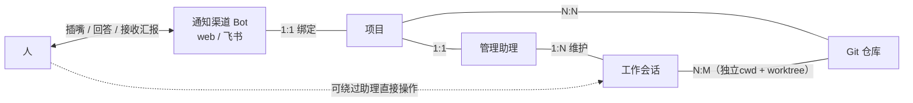
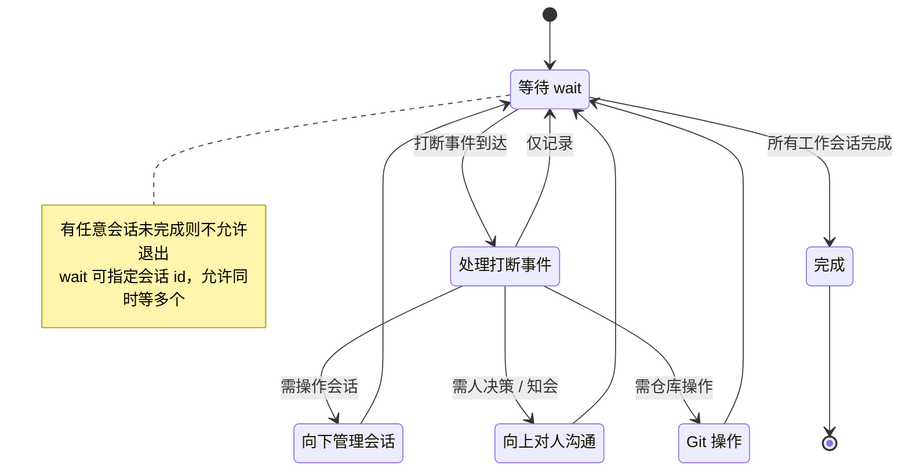
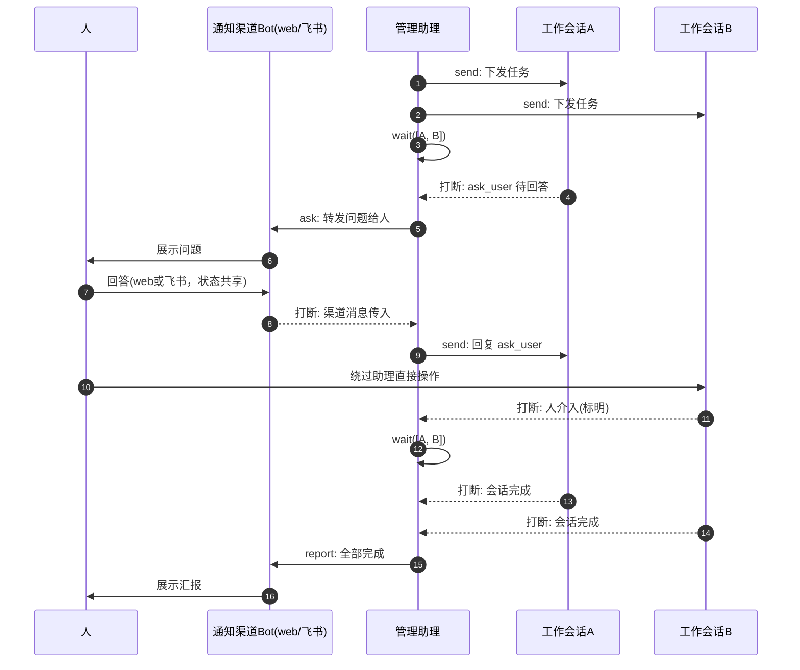

# NEXT-GEN-HARNESS

# 模型总览

NEXT-GEN-HARNESS 是一个项目驱动的多会话编排模型：每个项目配备一个**管理助理**，统一向下编排 N 个**工作会话**，并通过**通知渠道**与人保持双向沟通。

## 实体关系图

## 关系基数

- 项目 **1:1** 管理助理：每个项目有且仅有一个专属助理
- 管理助理 **1:N** 工作会话：一个助理维护多个工作会话
- 项目 **N:N** Git 仓库：项目可关联多个仓库，仓库可被多个项目复用
- 工作会话 **N:M** Git 仓库：一个会话可对应多个仓库（多工作场景）；每个会话创建时分配独立 cwd，仓库以 worktree 形式创建于其中
- 通知渠道为共享基础设施（web / 飞书），其中**每个 Bot 实例 1:1 绑定一个项目**；同一 Bot 的 web 侧与飞书侧状态共享，一处回答即全局生效

# 角色定义

## 工作会话

- 标准的全功能 Agent 会话
- **不感知管理会话**：本模型中，助理之于工作会话 ≈ 人之于 Agent 会话
- 工作会话之间互不感知，仅助理拥有全局视角
- 可对应多个 Git 仓库（多工作场景）
- 创建时分配独立 cwd，关联仓库以 worktree 形式创建于其中，会话间工作区相互隔离
- 助理可在运行中为会话追加 仓库 + 对应分支

## 管理助理

非标会话：仍是 Agent 会话，但工具集被裁剪为三类——向下管理、向上对人、Git 工具。

### 能力权限矩阵

|方向|能力|工具|说明|
| ------| ----------| --------------------| ----------------------------------------------------------------|
|向下|查看输出|view|查看会话最后的 Text 输出，支持分片查看|
|向下|取消|cancel|取消指定工作会话|
|向下|发送信息|send|三种模式：打断 / 排队 / 回复 ask_user 工具|
|向下|重命名|rename|修改工作会话标题|
|向下|阻塞等待|wait|指定会话 id，允许同时等待多个会话，可被中断|
|向下|添加仓库|add_repo|为指定会话追加 Git 仓库 + 对应分支（在其 cwd 中创建 worktree）|
|向上|主动汇报|report|向人汇报进展 / 结果|
|向上|提问|ask|向人提问；渠道状态共享，一处回答即全局生效|
|Git|仓库操作|git_*|全量 Git 操作，作用于项目绑定的 Git 仓库|
|自身|只读观察|read / glob / grep|全局生效，可读任意内容|
|自身|笔记写入|write|仅限助理自己的笔记工作区；改代码必须委托工作会话|

### 禁区

- 不直接修改代码：write 被限制在助理自己的笔记工作区，代码修改一律委托给工作会话执行
- 无工作会话的全量工具：助理不能直接代替会话干活，只能通过管理工具驱动会话
- 尽可能不替人做重要决定；有充足上下文信息的决定可以代办

### 预设工作规范（扩展口子）

助理的行为由一组可持续迭代的预设规范约束，后续逐步补充，例如：

- 项目工作笔记的固化规范（写什么、何时写、写到哪里）
- Git 操作规范（分支命名、提交粒度、合并策略等）

# 事件与打断模型

|事件|类型|说明|
| --------------------------------------| --------| --------------------------------------------|
|工作会话完成|打断|—|
|会话 ask_user 工具待回答|打断|—|
|人介入会话（发消息 / 代答 ask_user）|打断|必须标明是人介入|
|通知渠道消息传入|打断|—|
|（待定）|非打断|不打断当前工具，在下一次工具完成后自然插入|

**中断规则**：助理处于 wait / ask 期间，任意打断型事件到达 → 立即中断当前工具，转入事件处理。

# 助理主循环

- 助理必须主动 wait 所有工作会话；**有任意会话未完成则不允许退出**
- wait 指定会话 id，允许同时等待多个会话；等待期间可被任意打断型事件中断

# 人因接入

- 人可随时向助理插嘴（渠道消息 → 打断型事件）
- 助理可向人提问
- 人可绕过助理，直接进入工作会话操作；系统必须向助理推送"人介入"打断事件
- 渠道状态共享：web / 飞书任一处回答，等同于另一处回答

# 消息时序示例

# 开放问题

- 非打断型通知的具体类型（原文标注"还没想好"）
- "重要决定"与"有充足上下文可代办"的边界判定规则

‍
