# 流程图

Nexus 的完整流转。所有状态名、字段名取自 `prisma/schema/`，可直接对照。

## 目录

1. [全景](#1-全景)
2. [触发与分诊](#2-触发与分诊)
3. [任务生命周期](#3-任务生命周期)
4. [Worker 生命周期](#4-worker-生命周期)
5. [汇报与求助](#5-汇报与求助)
6. [收件箱投递规则](#6-收件箱投递规则)
7. [跨项目 Supervisor](#7-跨项目-supervisor)
8. [端到端时序](#8-端到端时序)
9. [状态速查表](#9-状态速查表)

---

## 1. 全景

四个代理、三层架构。

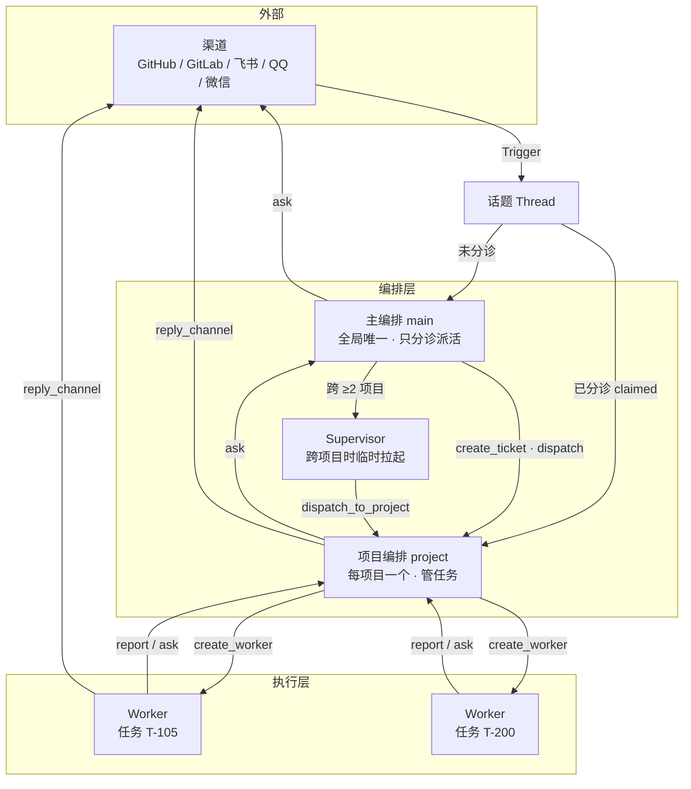

**代号约定**：`main` / `project` / `worker` / `supervisor` 是 Inbox 的 `type` 与 `origin` 取值，
也是四个代理在库里互相指代的名字。

> 图上只画了往外写的 `reply_channel`。**读方向 `read_channel` 四个角色都有**，
> 都指向同一个渠道，画出来会变成四根交叉的线，反而看不清。

---

## 2. 触发与分诊

一条 Trigger 落在 Thread 上之后，投给谁完全由 `Thread.triage` 决定。
**分诊只发生一次**，判完就固定下来，这是主编排不被同一件事反复叫醒的关键。

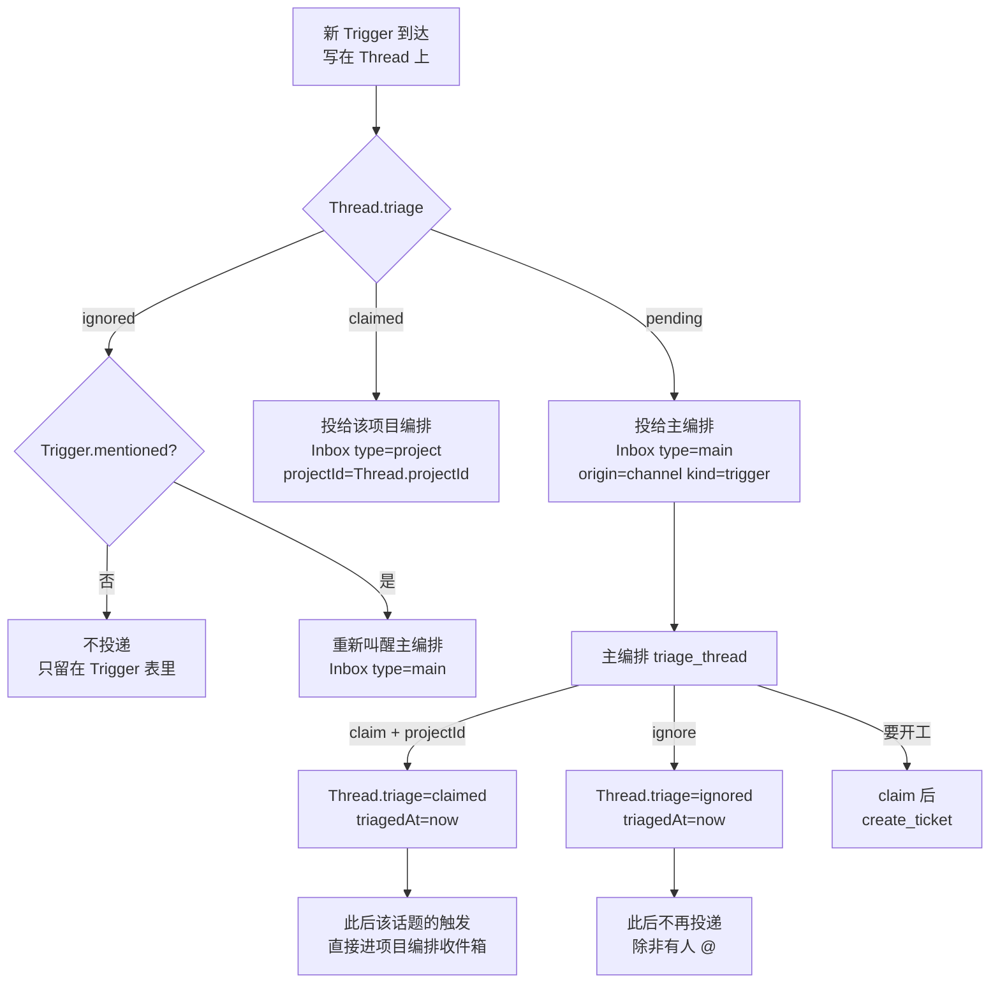

### 分诊判断依据

| 情况 | 动作 | 结果 |
| --- | --- | --- |
| 仓库能直接对上某个项目 | `triage_thread(claim, projectId)` | 后续触发归该项目 |
| 是提问 / 闲聊 / 通知，不需要动作 | `triage_thread(ignore)` | 不再投递 |
| 判完才发现要做 | `create_ticket` + `dispatch_ticket` | 任务进入项目 |
| 真拿不准 | `ask(askTo='user')` | 停下来问人，不猜 |

> **判重**：已有任务覆盖同一话题（`TicketThread` 有记录）时，不再开新任务，
> 只把 `triage` 判到同一项目。任务和话题的关系记在 `TicketThread` 上。

---

## 3. 任务生命周期

`Ticket.status` 的六种取值与流转。

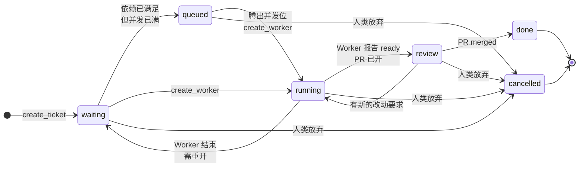

### 两条不存在的状态

**没有 `draft`。** 任务一旦存在，`projectId` 就必须是确定的。
「这件事我看到了，但还没定要不要做」属于话题分诊阶段（`Thread.triage`），
不该污染任务列表。

**没有 `attention`。** 一张工单完全可以一边 `running` 一边等人 ——
把 `status` 覆盖成 `attention` 会丢掉它本来跑到哪一步。所以「需介入」是**派生的**：

```sql
-- 需介入 = 存在指向它的 pending ask
SELECT * FROM ticket t
WHERE EXISTS (
  SELECT 1 FROM inbox i
  WHERE i.ticketId = t.id AND i.kind = 'ask' AND i.status = 'pending'
)
```

### 任务之间的关联

`TicketLink.kind` 两种，方向永远是 `ticketId` 指向 `relatedId`：

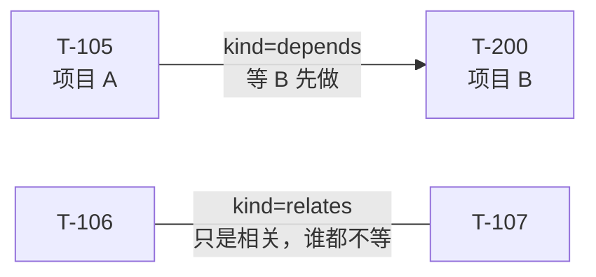

| kind | 语义 | 对状态的影响 |
| --- | --- | --- |
| `depends` | `relatedId` 没做完，`ticketId` 就停在 `waiting` | 阻塞推进 |
| `relates` | 只是相关（对称，存一条就够） | 无 |

---

## 4. Worker 生命周期

一个任务可以先后有多个 Worker（重试、换人），对应详情页的「执行会话 (1~5) 个」。

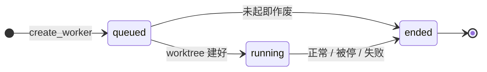

`branch` / `worktree` 在 `queued` 时为空，`running` 起填上，`ended` 后保留不删 ——
那一行是「这个任务曾经在哪个分支上干过」的唯一记录。完整字段变化见
[一个 Worker 的完整字段生命周期](#9-状态速查表)。

**一个 Worker 只对应一个 worktree。** 它没有「挂了几个仓库」的概念 ——
跨项目协作靠 Supervisor，不靠一个会话改多个仓库。

### Worker 结束原因

| `WorkerEndReason` | 含义 | 编排通常怎么做 |
| --- | --- | --- |
| `completed` | 正常结束 | 看 `reportState` 定任务状态 |
| `stopped` | 被 `cancel` 停掉 | 任务回 `waiting`，等重开 |
| `failed` | 失败 | 任务回 `waiting`，或转人工 |
| `restarted` | 宿主重启打断 | 任务回 `waiting`，自动重开 |

### 汇报状态

`Worker.reportState` 是**结构化通道**，和会话正文（`view` 读的那条）是两回事。

只有三种，因为 `report` 只讲事实、不等答复；「我在等一个答案」归 `ask`，不占状态位。

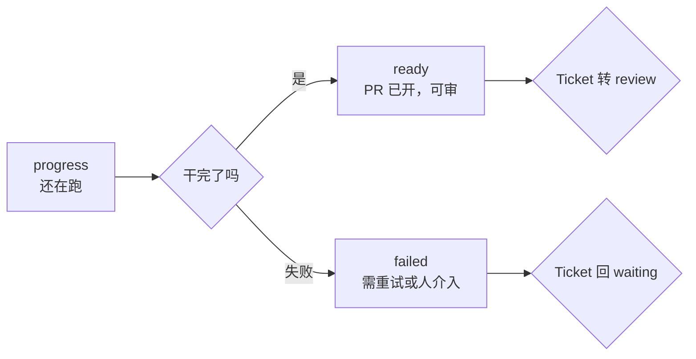

| `reportState` | 语义 | 编排动作 |
| --- | --- | --- |
| `progress` | 还在跑 | 不动，别打扰 |
| `ready` | 干完了，PR 已开 | `update_ticket(status=review)` |
| `failed` | 失败了 | `update_ticket(status=waiting)` 重开 |

「我卡住了，要你决定」不走 `report`，走 `ask`。

---

## 5. 汇报与求助

**人类也是一个收件人。** 把 `type=user` 放进 `InboxTarget` 之后，
「问人类」和「问上级」就变成同一件事的不同取值，而不是两套流程。

### 5.1 四个工具

| 工具 | 谁用 | 发给谁 | 等不等 |
| --- | --- | --- | --- |
| `report(state, summary, supervisorId?)` | project / worker / supervisor | 上级 | ❌ 发完继续 |
| `ask(question, supervisorId?)` | project / worker / supervisor | 上级 | ✅ 这条线停下 |
| `escalate(askId)` | project | 上级 | — 转发已有问题 |
| `ask_user(question, triggerId?)` | **只有 main** | 人类 | ✅ |

### 5.2 谁问到谁

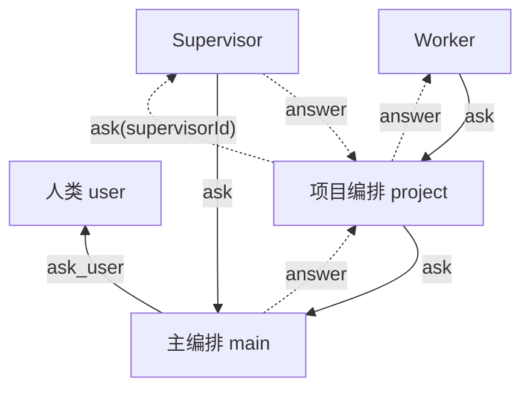

实线是默认路径，虚线是 Supervisor 在场时的旁路。

**`supervisorId` 只有 project 能用。** Worker 不知道 Supervisor 存不存在，也不该知道 ——
它只管干活，跨项目的事由项目编排往上转。

提问的定位靠 `Inbox.triggerId`：一条任务可以有好几个消息源，
但一个问题只会锚在一条触发上 —— 这是多消息源下唯一不歧义的答案。

### 5.2 升级链

升级**就地改 `type`，不新建记录**。一个问题从头到尾只有一条记录、一个身份，
任何时刻都只有一个处理者，永远不会出现两条 pending 抢同一件事。

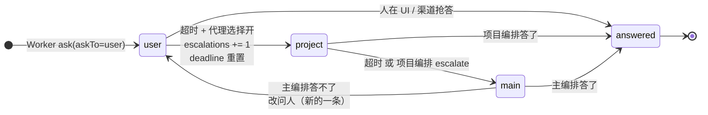

每一步都会更新：

| 字段 | 升级时 |
| --- | --- |
| `type` | 改成上一级 |
| `escalations` | +1 |
| `lastEscalatedAt` | now |
| `deadline` | 重置（已升到 main 则置空） |
| `status` | 保持 `pending` |

### 5.4 回答与回送

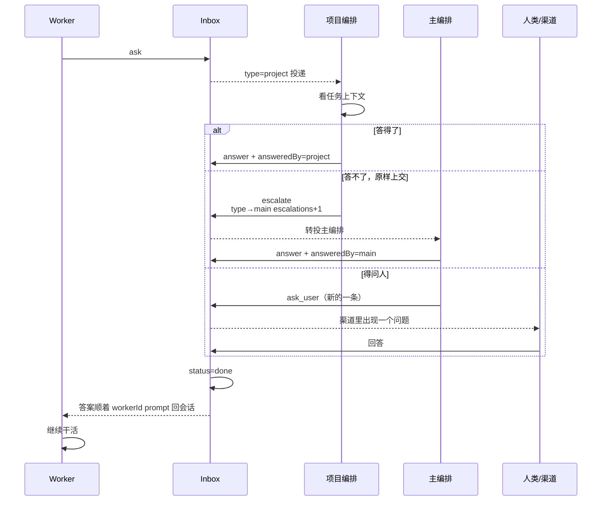

### 5.5 `escalate` 和 `ask` 的区别

最容易用错的一对。

| | `escalate(askId)` | `ask(question, ...)` |
| --- | --- | --- |
| 问题 | **同一个问题**，原样往上递 | **另一个新问题** |
| 记录 | 就地改现有那条的 `type` | 新建一条 Inbox |
| 原 ask | 已转走 | 还挂着，等我拿到答复再回去答 |
| 什么时候用 | 我不懂、上级懂 | 我看出这事得由上级决策 |

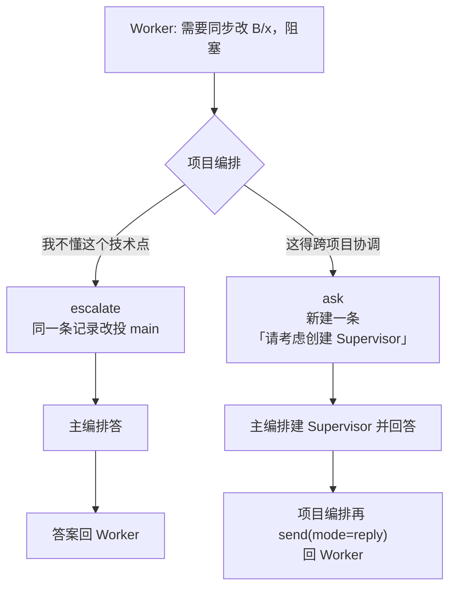

---

## 6. 收件箱投递规则

`Inbox.type` 是「此刻轮到谁」，`Inbox.origin` 是「谁发起的」。
两者合起来决定方向。

### 6.1 谁能投给谁

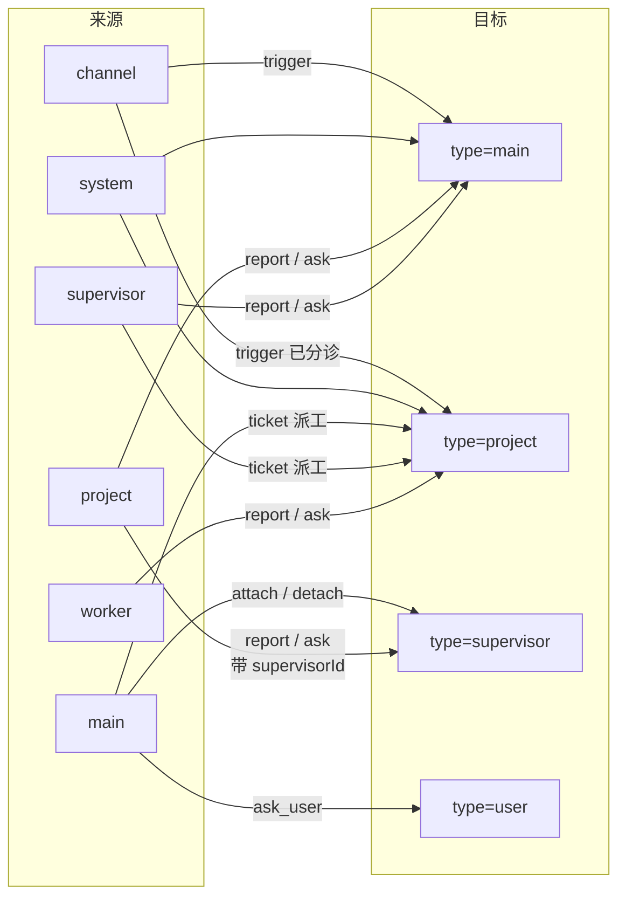

几条边界：

- **`type=user` 只有主编排能写**（`ask_user`）。其余角色没有这条路。
- **`type=supervisor` 只有主编排和项目编排能写**。Worker 不知道它存在。
- **Worker 没有收件箱**。它短命、被动、在等的时候是阻塞的，
  所以上级的话必须直接 prompt 进会话，不能进队列等它来取。
- **Supervisor 不写 `type=user`**。要对外说话，`ask` 主编排。

### 6.2 消费与提示

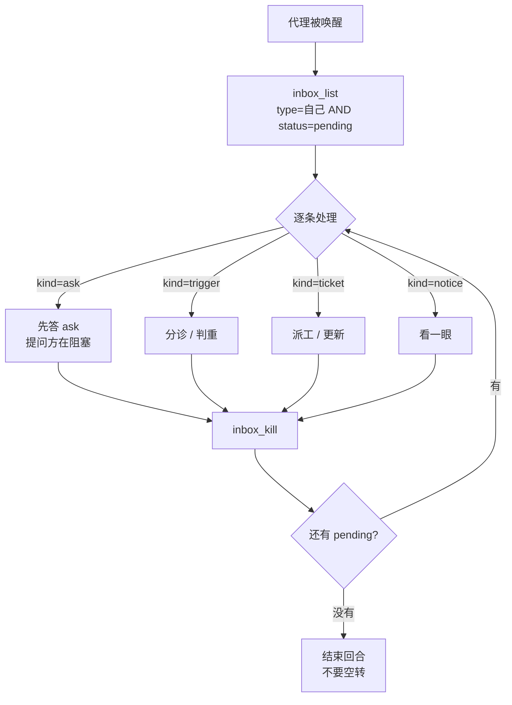

会话结束（或空闲）时，框架数一下自己名下 `status = pending` 的条数，
提示「你有 N 条消息未处理」。**超时检查不靠后台定时器**，和这次提示共用同一次会话钩子。

---

## 7. 跨项目 Supervisor

一个 Worker 只有一个 worktree，所以跨项目**没有别的路**：要么拉 Supervisor，
要么拆成两条独立任务各自走。这两种都由主编排决定。

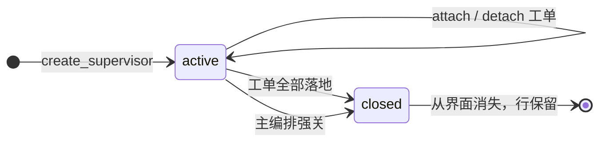

`active` 期间它做的事（不改变状态）：

| 动作 | 触发时机 |
| --- | --- |
| `dispatch_to_project` | 某项目还没派活，或有新步骤要推进 |
| `link_dependency` | 发现「谁等谁」，写进 `TicketLink(kind=depends)` |
| `answer` | 项目编排把下级 ask 递上来了 |
| `report` | 工单状态变了，让主编排知道 |
| `ask` | 自己推不动，往主编排上报 |

### 7.1 它被谁叫醒

没有后台定时器，也没有程序推送。只有三个唤醒源：

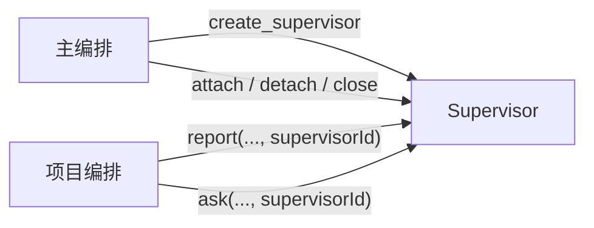

**代价：没人上报就等于永远不知道。** 所以每次醒来第一件事是 `list_tickets`
自己看一遍，不能只信收件箱里那一条。

项目编排侧的纪律：工单进入终态（`done` / `cancelled`）且在某 Supervisor 下时，
**必须** `report` 一次并带 `supervisorId`。

同项目内 A 依赖 B 不需要 Supervisor —— 项目编排自己 `list_tasks` 就够。

### 7.2 范围调整

Supervisor 不自己改范围，它 `ask` 主编排：

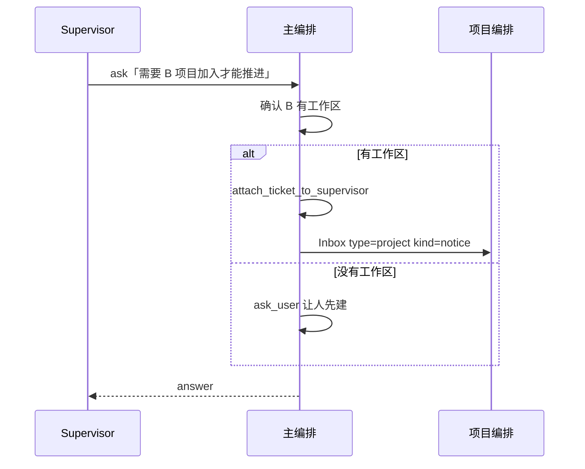

`detach` 时工单退回原项目编排，**不取消** —— 取消是人的决定。

### 7.3 收工条件

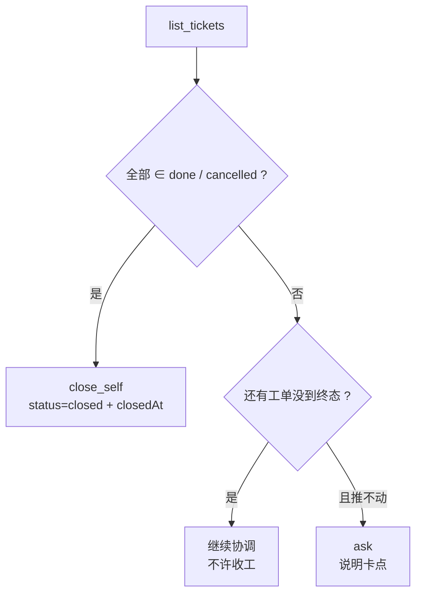

**有工单还没走到终态时不许收工**，那是还没做完。
`close_self` 之后行不删 —— 那几张工单还指着它说明自己当初为什么存在。

---

## 8. 端到端时序

一个完整例子：GitHub 上一个 issue @ 了我们，最终合出 PR。

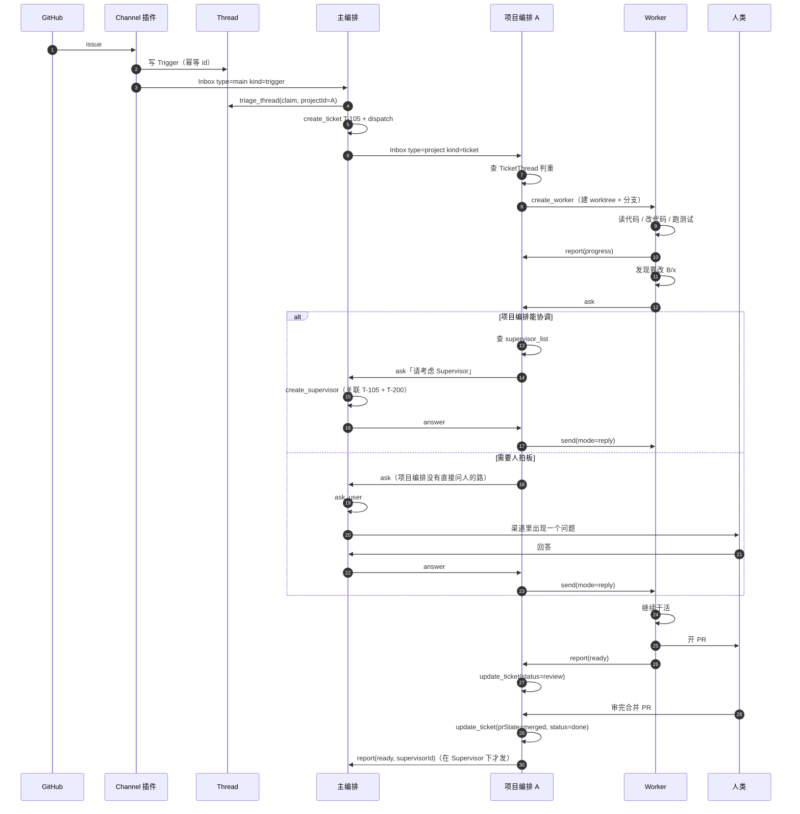

### 另一条常见路径：同话题追加消息

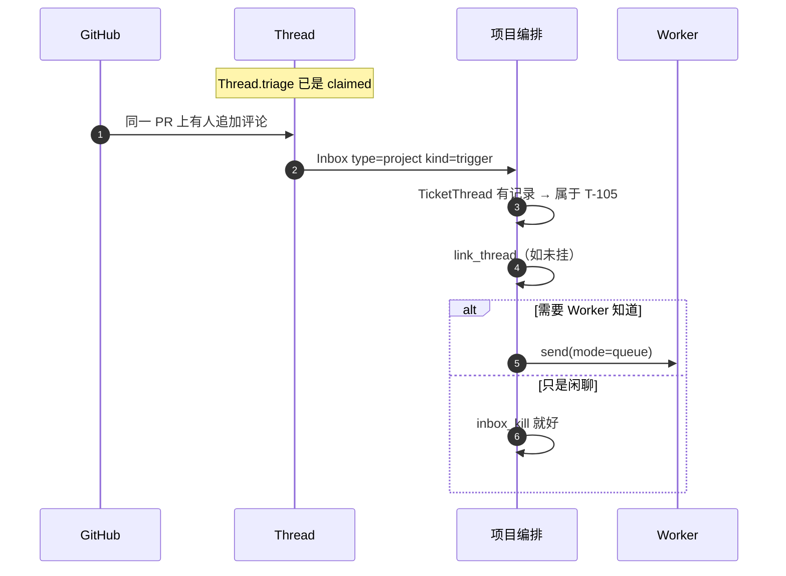

**这条路径不经过主编排** —— 分诊已经完成，主编排不该被同一件事反复叫醒。

---

## 9. 状态速查表

### 枚举取值总表

| 枚举 | 取值 |
| --- | --- |
| `AccountRole` | `bot` · `admin` |
| `AccountStatus` | `online` · `offline` |
| `ThreadKind` | `issue` · `pull` · `chat` |
| `ThreadTriage` | `pending` · `claimed` · `ignored` |
| `TriggerKind` | `comment` · `open` · `close` · `merge` · `ci` · `push` |
| `TicketStatus` | `waiting` · `queued` · `running` · `review` · `done` · `cancelled` |
| `PullRequestState` | `open` · `merged` · `closed` |
| `CiState` | `pending` · `running` · `passing` · `failing` |
| `TicketLinkKind` | `depends` · `relates` |
| `WorkerStatus` | `queued` · `running` · `ended` |
| `WorkerEndReason` | `completed` · `stopped` · `failed` · `restarted` |
| `ReportState` | `progress` · `ready` · `failed` |
| `InboxTarget` | `user` · `main` · `project` · `supervisor` |
| `InboxOrigin` | `channel` · `main` · `project` · `worker` · `supervisor` · `system` |
| `InboxStatus` | `pending` · `done` |
| `InboxKind` | `trigger` · `ticket` · `ask` · `notice` |
| `InboxAnsweredBy` | `user` · `main` · `project` · `supervisor` · `worker` |
| `SupervisorStatus` | `active` · `closed` |

### 工具矩阵

| 工具 | main | project | worker | supervisor |
| --- | :-: | :-: | :-: | :-: |
| `report` | ❌ | ✅ | ✅ | ✅ |
| `ask` | ❌ | ✅ | ✅ | ✅ |
| `ask_user` | ✅ | ❌ | ❌ | ❌ |
| `escalate` | ❌ | ✅ | ❌ | ❌ |
| `answer` | ✅ | ❌ | ❌ | ✅ |
| `read_channel` | ✅ | ✅ | ✅ 限本任务 | ✅ |
| `reply_channel` | ✅ | ✅ | ✅ | ❌ |

`report` 说事实，`ask` 要决定。主编排没有 `report`（它是终点），也没有 `ask`（它没有上级）。


### 派生状态

有些「状态」不占字段，直接查出来：

| 想要 | 怎么算 |
| --- | --- |
| 任务需介入 | 存在 `ticketId` 指向它、`kind=ask`、`status=pending` 的 Inbox |
| 收件箱未读数 | `type=自己 AND status=pending` 的 count |
| 已升级的 ask | `escalations > 0` |
| 任务实际负责的 Worker | `Worker.ticketId` 最新那条（或 `status=running` 那条） |
| Supervisor 该收工 | 关联工单全部 ∈ `{done, cancelled}` |
| 话题是不是已经判过 | `Thread.triage != pending` |

### 一个 Worker 的完整字段生命周期

| 时刻 | `status` | `branch` / `worktree` | `reportState` | `endedReason` |
| --- | --- | --- | --- | --- |
| `create_worker` 登记 | `queued` | 空 | 空 | 空 |
| worktree 建好、会话起来 | `running` | 已填 | 空 | 空 |
| 跑起来第一次汇报 | `running` | 已填 | `progress` | 空 |
| 干完 | `running` | 已填 | `ready` | 空 |
| 收工 | `ended` | 已填 | `ready` | `completed` |
