# 流程图

Nexus 的完整流转。状态名、字段名取自 `prisma/schema/`。
各代理的工具与提示词见 [agents/](agents/README.md)，这里只讲**跨代理的流转**。

1. [全景](#1-全景)
2. [触发与分诊](#2-触发与分诊)
3. [任务生命周期](#3-任务生命周期)
4. [Worker 生命周期](#4-worker-生命周期)
5. [汇报与求助](#5-汇报与求助)
6. [收件箱投递规则](#6-收件箱投递规则)
7. [跨项目 Supervisor](#7-跨项目-supervisor)
8. [触发点：PR 与 CI](#8-触发点pr-与-ci)
9. [端到端时序](#9-端到端时序)
10. [状态速查表](#10-状态速查表)

---

## 1. 全景

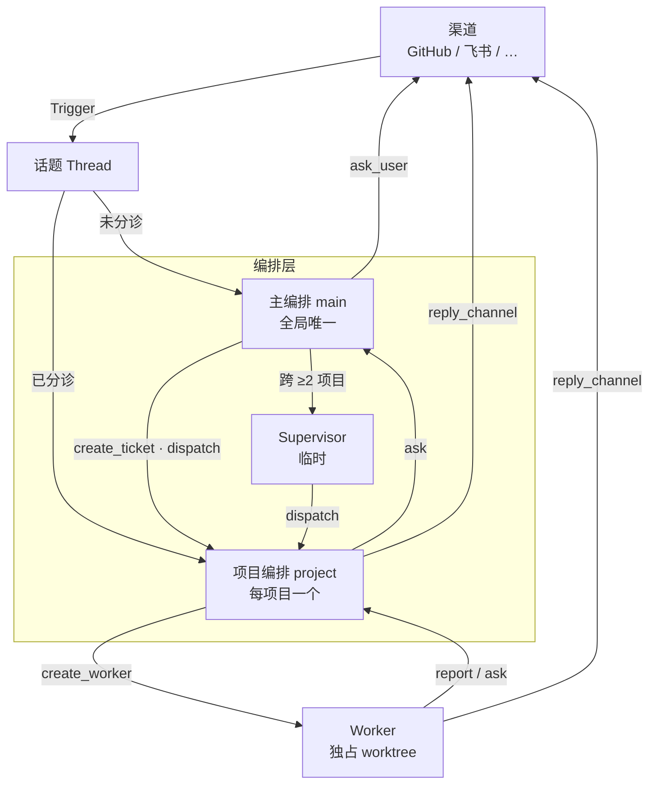

`main` / `project` / `worker` / `supervisor` 既是 Inbox 的 `type` 取值，
也是四个代理在库里互相指代的名字。

图中只画了往外写的 `reply_channel`。**读方向 `read_channel` 四个角色都有**，
画出来会变成四根交叉的线，反而看不清。

---

## 2. 触发与分诊

投给谁完全由 `Thread.triage` 决定。**分诊只发生一次**，之后固定。

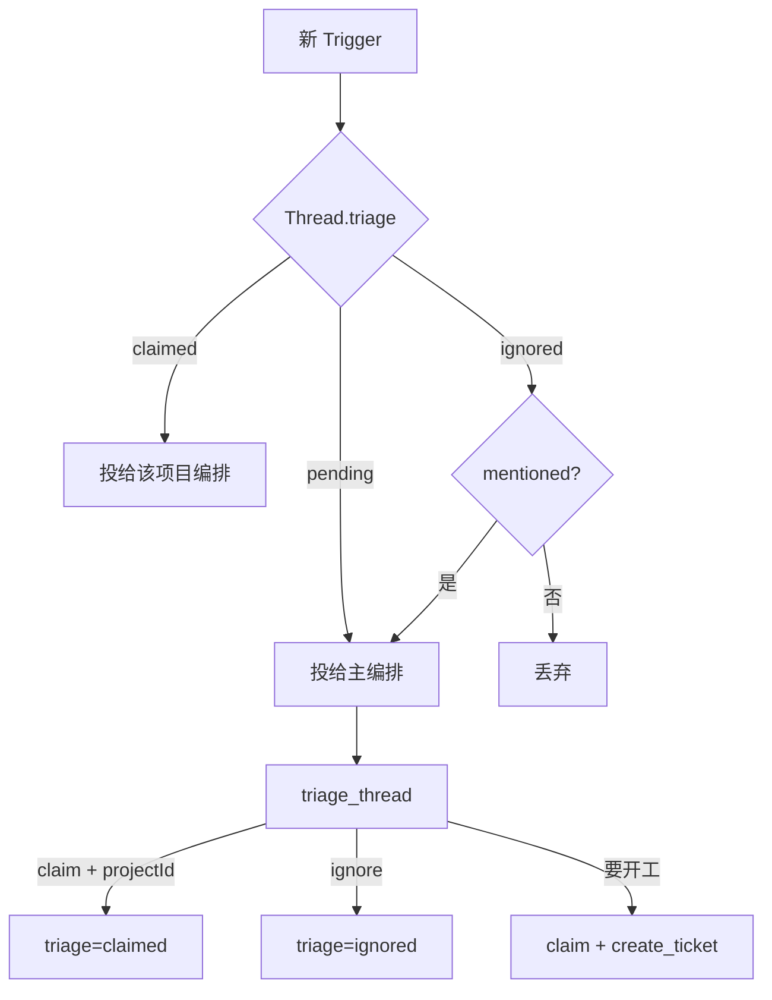

| 情况 | 动作 |
| --- | --- |
| 仓库能对上某个项目 | `claim` |
| 提问 / 闲聊 / 通知 | `ignore` |
| 判完才发现要做 | `claim` + `create_ticket` + `dispatch_ticket` |
| 真拿不准 | `ask_user` |

`ignored` 不是彻底静默 —— `mentioned=true` 时仍会重新叫醒主编排。

**判重**：已有任务覆盖同一话题（`TicketThread` 有记录）→ 不开新票，
只把 `triage` 判到同一项目。

---

## 3. 任务生命周期

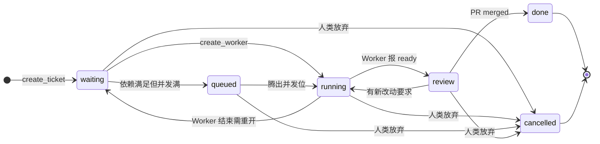

### 两个不存在的状态

**没有 `draft`。** 任务一旦存在，`projectId` 就必须确定。
「还没想好归谁」属于话题分诊阶段，不该污染任务列表。

**没有 `attention`。** 工单可以一边 `running` 一边等人 —— 覆盖 `status`
会丢掉它本来跑到哪一步。所以「需介入」是派生的：

```sql
SELECT * FROM ticket t WHERE EXISTS (
  SELECT 1 FROM inbox i
  WHERE i.ticketId = t.id AND i.kind = 'ask' AND i.status = 'pending')
```

### 任务之间的关联

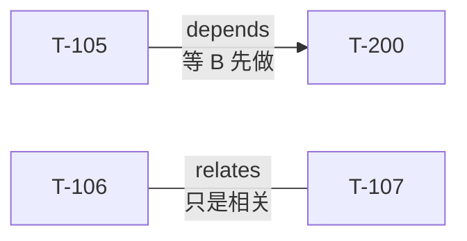

| kind | 影响 |
| --- | --- |
| `depends` | `relatedId` 没做完，`ticketId` 停在 `waiting` |
| `relates` | 无 |

`depends` 还有第二个作用：`relatedId` 到终态时**系统自动通知 Supervisor**（见第 7 章）。

---

## 4. Worker 生命周期

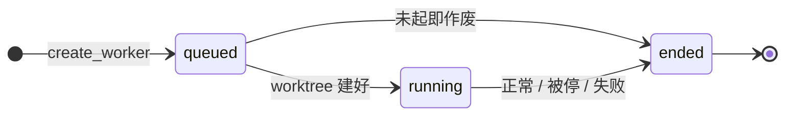

`branch` / `worktree` 在 `queued` 时为空，`running` 起填上，`ended` 后保留不删 ——
那是「这个任务曾经在哪个分支上干过」的唯一记录。

### 结束原因与后续

| `WorkerEndReason` | 编排动作 |
| --- | --- |
| `completed` | 看 `reportState` 定任务状态 |
| `stopped` | 任务回 `waiting` |
| `failed` | 回 `waiting`，或转人工 |
| `restarted` | 回 `waiting`，自动重开 |

### 汇报状态

`reportState` 是结构化通道，和会话正文（`view` 读的）是两回事。

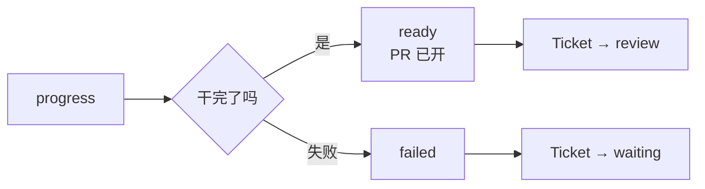

只有三种 —— `report` 只讲事实，「我在等答复」归 `ask`，不占状态位。

---

## 5. 汇报与求助

**人类也是一个收件人。** 把 `type=user` 放进 `InboxTarget` 之后，
「问人」和「问上级」是同一件事的不同取值。

### 谁问到谁

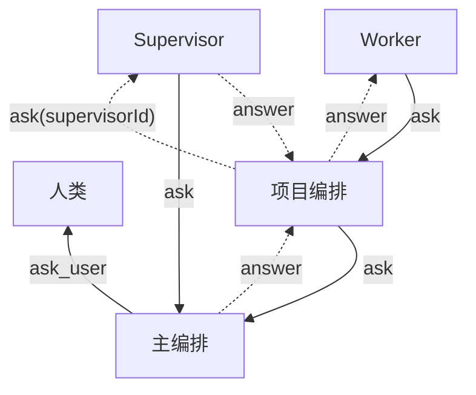

实线默认路径，虚线是 Supervisor 在场时的旁路。

### 升级链

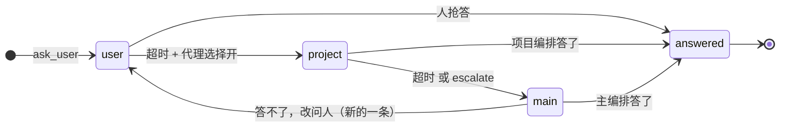

升级**就地改 `type`，不新建记录** —— 一个问题只有一条记录、一个身份，
任何时候只有一个处理者。

每次升级更新：`type` 改上一级、`escalations+1`、`lastEscalatedAt=now`、
`deadline` 重置（升到 main 则置空）、`status` 保持 `pending`。

渠道收尾只有一条规则：**只有从 `user` 升级出去的那一次要回渠道补一句话**。
因为只有 `type=user` 意味着问题已经问出口了。

### 回答与回送

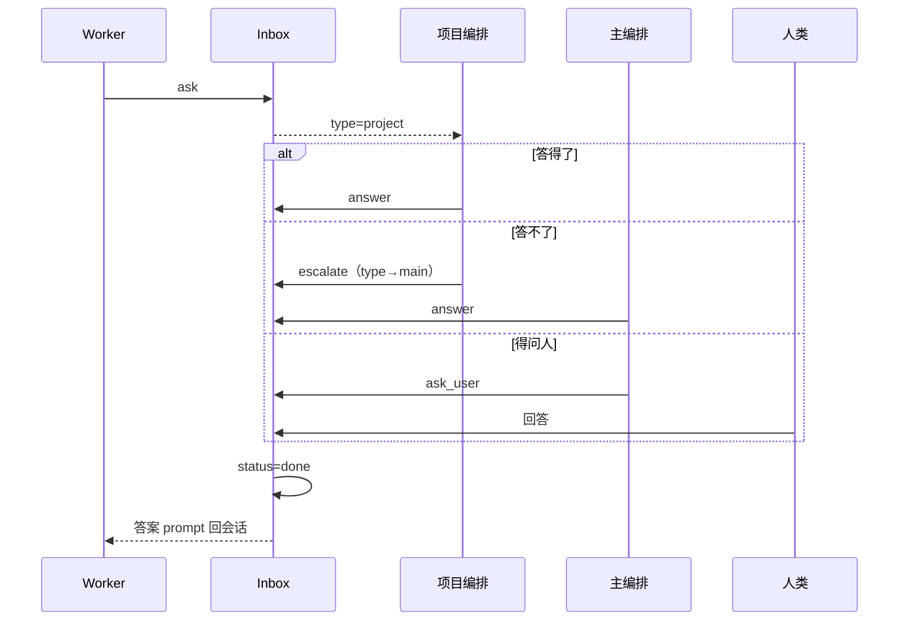

---

## 6. 收件箱投递规则

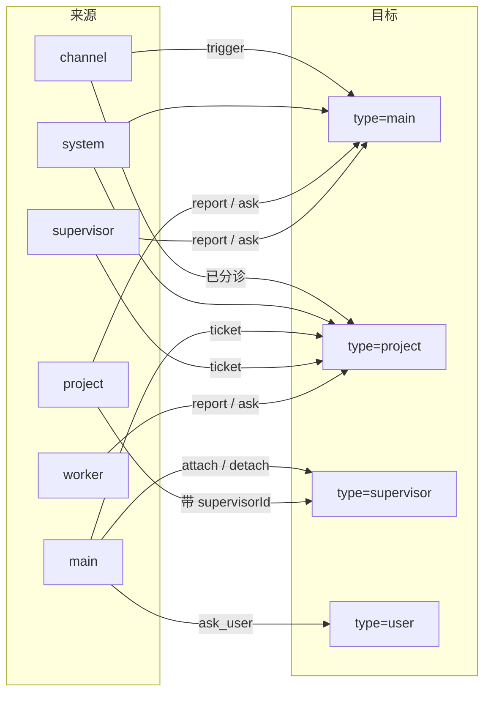

三条边界：

- **`type=user` 只有 main 能写**（`ask_user`）
- **`type=supervisor` 只有 main 和 project 能写** —— Worker 不知道它存在
- **Worker 没有收件箱**，上级的话直接 prompt 进会话

### 消费

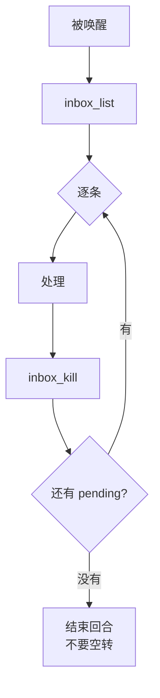

会话结束或空闲时，框架数一下 `status=pending` 的条数提示「你有 N 条消息未处理」。
**超时检查不靠后台定时器**，和这次提示共用同一次会话钩子。

---

## 7. 跨项目 Supervisor


### 唤醒：四个来源

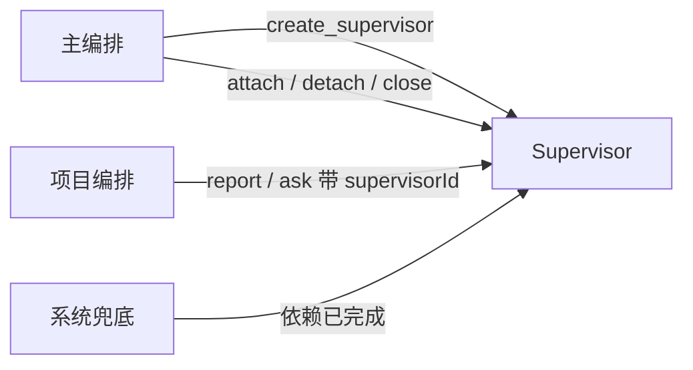

**前三个是常规，第四个是保险。**

`link_dependency` 后，当 `dependsOn` 走到终态，插件自动投一条 notice：

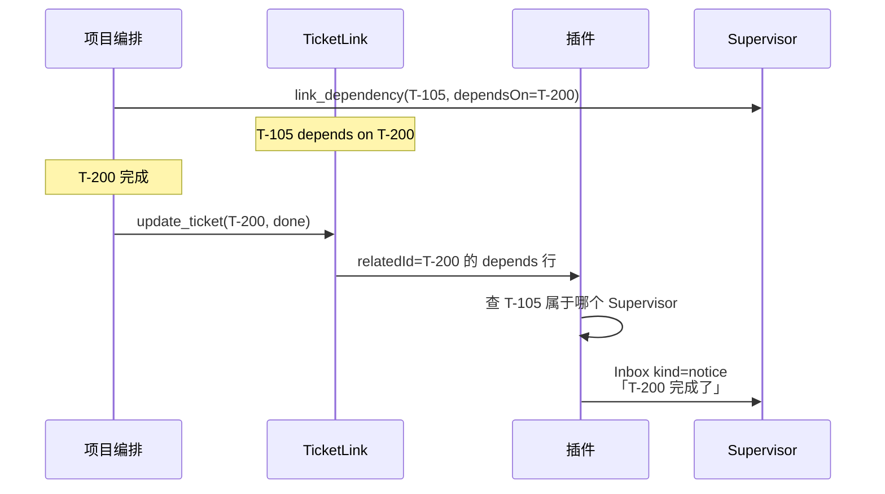

**为什么需要**：项目编排本来就该在工单进终态时 `report`，
但漏报会让整条跨项目链路停摆。依赖关系已经在 `TicketLink` 里，顺手兜一下不费事。

它**只兜一层**：同项目内的依赖没有 Supervisor，系统静默，由项目编排自己看 `list_tasks`。

### 范围调整

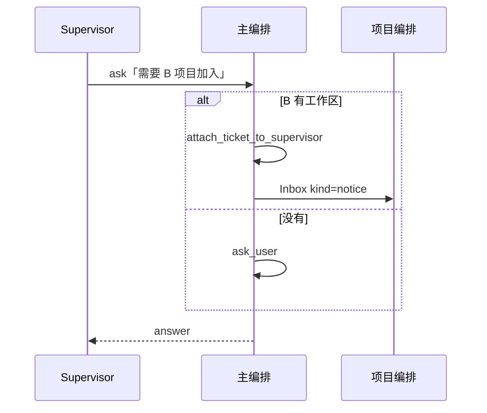

`detach` 时退回原项目编排，**不取消** —— 取消是人的决定。

### 收工

```
全部关联工单 ∈ { done, cancelled } → close_self()
```

有工单没到终态就不许收工。

---

## 8. 触发点：PR 与 CI

### 8.1 PR 上的事件

| 事件 | `TriggerKind` | 走触发？ |
| --- | --- | --- |
| PR 打开 | `open` | ✅ |
| 对话区 / 行内评论 | `comment` | ✅ |
| Review（含无正文的通过打回） | `comment` | ✅ |
| CI 变化 | `ci` | ✅ |
| **合并 / 关闭** | — | ❌ **不发触发** |

**Review 没写正文但点了 Approve 也要发** —— 用户点 Approve 这个动作本身就是答复，
吞掉它，等审批的 Worker 就永远等不到。

PR 和 issue 共用编号，id 格式一致；但**话题不同**（issue 是 `github:42`，PR 是 `github:88`）。

### 8.2 PR 归谁处理

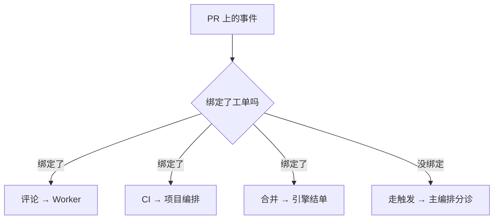

**主编排只在没有归属时出场。** 已绑定 PR 的任何事件都不经过它。

### 8.3 合并/关闭：引擎结单

```
PR 合并 / 关闭
  → closePull → threadClosed(thread, outcome, at)
  → 引擎直接 end(ticket)                          ← 结单在这里
  → emit('ticket.ended')
      ├─ 主编排收件箱 kind=notice                  ← 只是通知
      └─ 非 GitHub 渠道补一句                      ← GitHub 时间线已有
```

三个关键点：

**① 结单是引擎做的。** 编排收到 notice 通知，不是「请你处理」。

**② `unfinished` 例外。** Worker 还有没报 `ready` 的活，或 PR 关后又起了新 Assignment
→ **不结单**，等 `ready`。防止「PR 合了但活没干完」被误判完成。

**③ `followsDone`：关注的话题全关才结单。** 自己开的 PR 全关了，
或没开 PR 时所有关注话题都关了。

我们的等价实现放在**渠道插件**（Host half）：

```
1. 按 TicketThread 找到跟进这张 PR 的工单
2. 检查 unfinished
3. 没有 → update_ticket(prState, status=done, endedAt)
4. 有   → 只记 prState，留 review，等 report(ready)
5. 主编排 + 项目编排各投一条 kind=notice
6. 非 GitHub 渠道发一句话；GitHub 上不发
```

**为什么不走触发**：PR 合并时没有要判断的东西 —— 结论已经在 GitHub 上了。
走触发等于让编排重复确认一件已确定的事，还多一个「忘了处理就永远不关」的失败点。

### 8.4 PR 归哪张工单

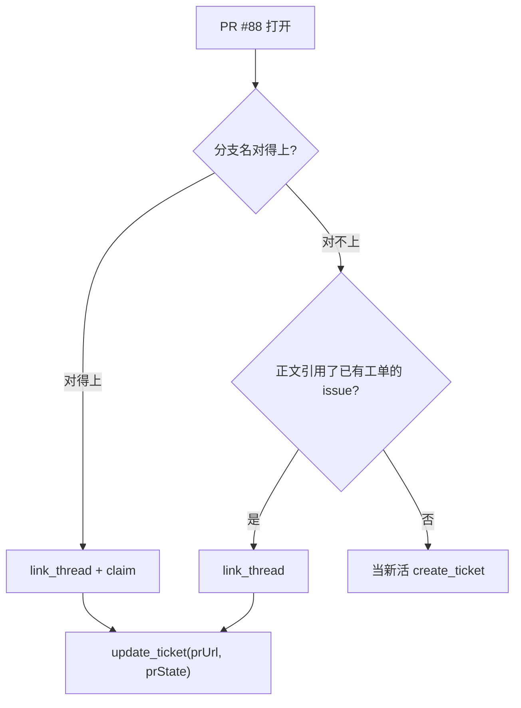

判断依据按可靠性排序：

| 依据 | 可靠性 |
| --- | --- |
| 分支名末段 == `Worker.branch` 末段 | **确定性**，纯字符串比较 |
| 正文 `Closes #42` | 高，但作者可能不写 |
| 标题 / 内容相似 | 低，不要用 |

**分支名优先**。所以建分支时末段必须就是任务号：`nexus/T-105`。
不这么做，PR 和工单关联不上，只能靠模型读正文猜。

关联错了：删掉 `TicketThread` 那行重挂即可，不用回滚 PR。

### 8.5 两套 CI

| | PR CI | 分支 CI |
| --- | --- | --- |
| 看谁 | open ticket 的 PR | 默认分支 head |
| 话题 | 跟 PR 共用 | **独立**（`github:ci:main`） |
| 能回复 | ✅ | ❌ **没有地址** |
| 开关 | 无条件 | 渠道开关，默认关 |

### 8.6 为什么必须防抖

一次 CI 运行会产生几十次状态变化，每次都发会把收件箱刷满。
两套都用 `CiWatch` 记住上次指纹，**只有变了才发**。

#### PR CI

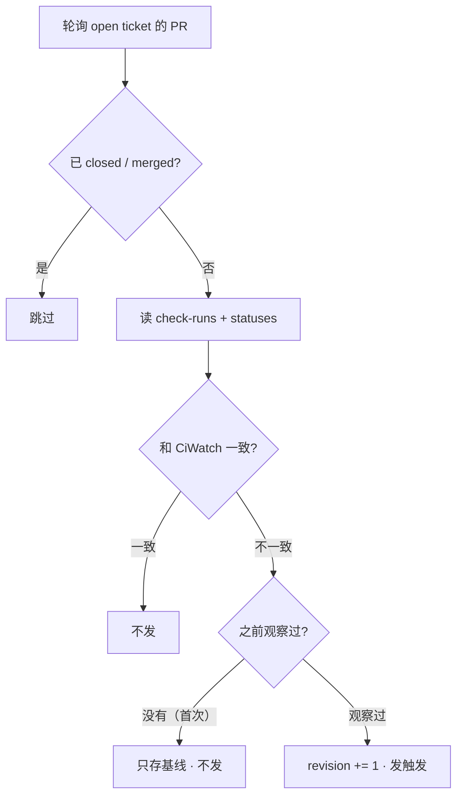

**首次只建基线**是最容易漏的一行。没有它，每接一张新任务，
第一次轮询就会因为「和空值不同」误报一次。

#### 分支 CI

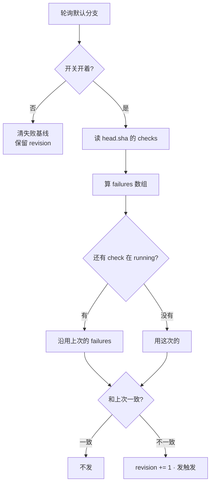

第 E 步是整个分支 CI 的核心：**还有 check 在跑，就假装失败集合没变。**

没有它，跑到一半时「3 个失败」→「2 个失败」→「1 个失败」会连触发三次。
有了它，恢复只在全绿后报一次。

#### 其他细节

- **首次基线**：刚开开关或分支改名时 `known` 为空，只存不发。
- **失败判定**：`failure` · `timed_out` · `cancelled` · `action_required` ·
  `startup_failure` · `error`。check-runs 看 `conclusion`，旧式 status 看 `state`。
- **投递**：PR CI 跟 PR 的 `triage` 走；分支 CI 直接投项目编排，不走分诊 ——
  仓库已注册为项目，归属确定，没有歧义。

### 8.7 分支 CI 不能回复

`branchCiTrigger` 根本没有 channel 字段。`reply_channel` 拿到
`ThreadKind=ci` 的触发必须**明确报错**，不能猜一个地方发。

---

## 9. 端到端时序

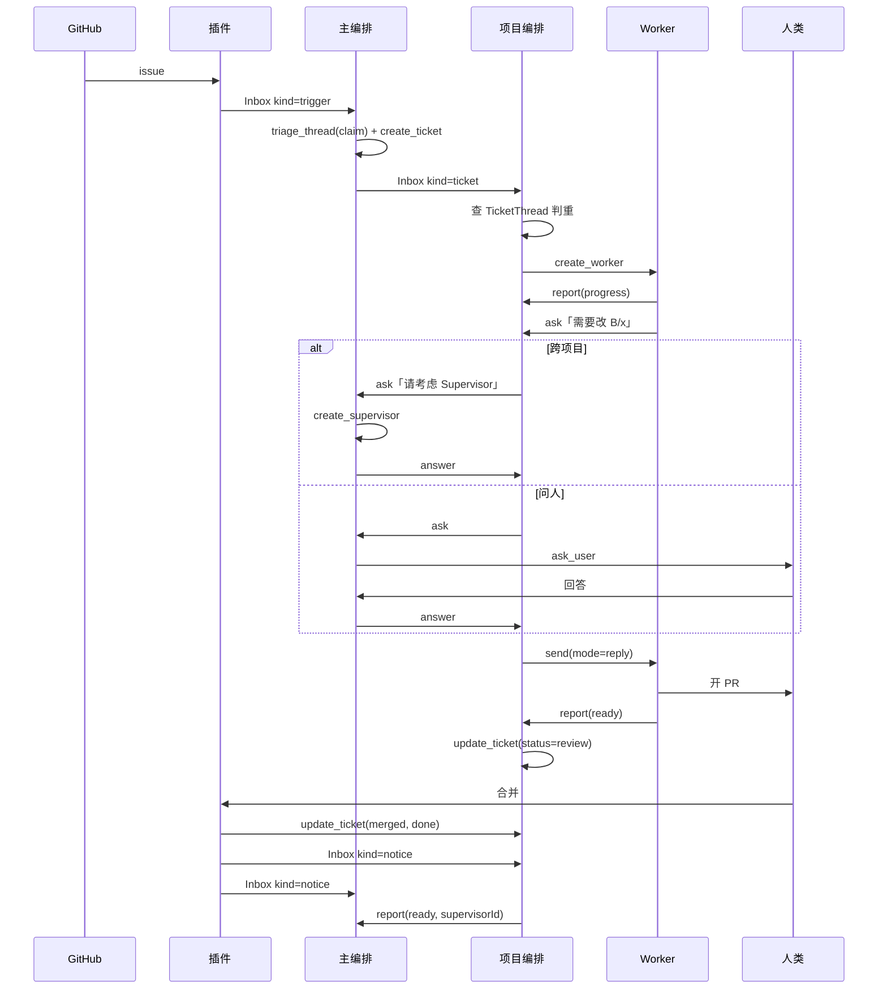

### 同话题追加消息

```mermaid
sequenceDiagram
    participant GH as GitHub
    participant P as 项目编排
    participant W as Worker

    Note over P: Thread.triage 已是 claimed
    GH->>P: Inbox kind=trigger
    P->>P: TicketThread 有记录 → 属于 T-105
    alt 需要 Worker 知道
        P->>W: send(mode=queue)
    else 闲聊
        P->>P: inbox_kill
    end
```

**这条路径不经过主编排** —— 分诊已完成，不该被同一件事反复叫醒。

---

## 10. 状态速查表

| 枚举 | 取值 |
| --- | --- |
| `ThreadKind` | `issue` · `pull` · `chat` · `ci` |
| `ThreadTriage` | `pending` · `claimed` · `ignored` |
| `TriggerKind` | `comment` · `open` · `close` · `ci` · `push` |
| `TicketStatus` | `waiting` · `queued` · `running` · `review` · `done` · `cancelled` |
| `PullRequestState` | `open` · `merged` · `closed` |
| `CiState` | `pending` · `running` · `passing` · `failing` |
| `TicketLinkKind` | `depends` · `relates` |
| `WorkerStatus` | `queued` · `running` · `ended` |
| `WorkerEndReason` | `completed` · `stopped` · `failed` · `restarted` |
| `ReportState` | `progress` · `ready` · `failed` |
| `InboxTarget` | `user` · `main` · `project` · `supervisor` |
| `InboxOrigin` | `channel` · `main` · `project` · `worker` · `supervisor` · `system` |
| `InboxStatus` | `pending` · `done` |
| `InboxKind` | `trigger` · `ticket` · `ask` · `notice` |
| `InboxAnsweredBy` | `user` · `main` · `project` · `supervisor` · `worker` |
| `SupervisorStatus` | `active` · `closed` |

### 派生状态

| 想要 | 怎么算 |
| --- | --- |
| 任务需介入 | 存在指向它、`kind=ask`、`status=pending` 的 Inbox |
| 收件箱未读数 | `type=自己 AND status=pending` 的 count |
| 已升级的 ask | `escalations > 0` |
| Supervisor 该收工 | 关联工单全部 ∈ `{done, cancelled}` |
| 某票是不是某 Supervisor 的 | `SupervisorTicket` 有记录 |

工具矩阵见 [agents/README.md](agents/README.md#工具矩阵)，不在两处各写一遍。
